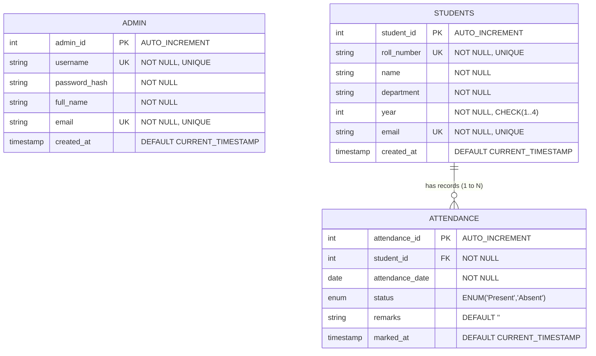

# 🎓 Student Attendance Management System (AMS)
### **BTech 2nd Year Computer Science & Engineering — DBMS Mini Project**

A full-stack, responsive web application for managing student records, tracking daily lecture/laboratory attendance, and generating automated attendance percentage reports backed by a normalized **MySQL** relational database.

---

## 📋 Table of Contents
1. [Project Overview](#-project-overview)
2. [Technology Stack](#-technology-stack)
3. [Key Modules & Features](#-key-modules--features)
4. [Database Design & Entity Relationship (ER) Diagram](#-database-design--entity-relationship-er-diagram)
5. [Database Schema Details & Integrity Constraints](#-database-schema-details--integrity-constraints)
6. [Core SQL Queries Used in the Project](#-core-sql-queries-used-in-the-project)
7. [Installation & Setup Instructions](#-installation--setup-instructions)
8. [Configuring the MySQL Connection](#-configuring-the-mysql-connection)
9. [Running the Application in VS Code](#-running-the-application-in-vs-code)
10. [Default Login Credentials](#-default-login-credentials)
11. [Project Directory Structure](#-project-directory-structure)
12. [DBMS Viva Questions & Key Explanations](#-dbms-viva-questions--key-explanations)

---

## 🌟 Project Overview

The **Student Attendance Management System** replaces tedious paper-based roll registers with a secure, centralized database system. Faculty and administrators can register students, take daily attendance with one-click toggles, filter attendance sheets by department/academic year, prevent duplicate markings on the same date, and instantly compute real-time attendance percentages using relational database aggregations.

### Primary Objectives:
- **Relational Integrity**: Enforce primary keys, unique constraints, and foreign key cascades to ensure consistent data.
- **Automated Attendance Reporting**: Calculate individual attendance percentages dynamically using SQL queries without storing derived data (maintains 3NF normalization).
- **Duplicate Prevention**: Prevent duplicate attendance records for the same student on the same date using composite unique constraints and `ON DUPLICATE KEY UPDATE`.
- **Zero-Downtime Architecture**: Primary support for MySQL with an automatic SQLite fallback mechanism for flexible evaluation in any lab or presentation setting.

---

## 💻 Technology Stack

| Layer | Technologies Used |
| :--- | :--- |
| **Frontend** | HTML5, CSS3 (Modern Blue & White palette), Vanilla JavaScript (ES6) |
| **Backend** | Python 3.10+, Flask 3.0+ |
| **Database** | MySQL 8.0+ / MariaDB (Primary) via `PyMySQL` connector (with local SQLite fallback) |
| **Authentication** | Secure password hashing via `werkzeug.security` (Scrypt / PBKDF2) |
| **Development Environment** | Visual Studio Code, Windows PowerShell / Bash |

---

## 🚀 Key Modules & Features

### 1. 🔐 Admin Authentication Module
- Secure login portal with credential verification against the `admin` table.
- Password hashing prevents plaintext storage of credentials.
- Protected routes using Flask `@login_required` decorator.
- Session-based user tracking and safe logout.

### 2. 📊 Dashboard Overview Module
- **Real-time dynamic metric cards** (not static or hardcoded):
  - Total registered students in the database (`COUNT(*)`).
  - Present students on selected date (`COUNT(status = 'Present')`).
  - Absent students on selected date (`COUNT(status = 'Absent')`).
  - System-wide overall attendance percentage.
- **Session History Table**: Displays past lecture dates, turnout percentage, and direct links to edit past sheets.
- **Department Distribution Bars**: Visual breakdown of student enrollment per engineering department.

### 3. 👥 Student Management Module (CRUD)
- **Add Student**: Form validating Name, Roll Number, Department, Year, and Email.
- **Uniqueness Check**: Rejects duplicate roll numbers and email addresses before database insertion.
- **View All Students**: Responsive table with live client-side search and server-side filtering.
- **Edit Student**: Pre-populated modal for updating existing student details.
- **Delete Student**: Confirmation modal; automatically cleans up attendance records via database `ON DELETE CASCADE`.

### 4. 📝 Attendance Recording Module
- **Date Selector**: Select any past or current date to view or mark attendance.
- **Roster Population**: Employs SQL `LEFT JOIN` so all registered students appear regardless of whether attendance was previously recorded.
- **Interactive Toggles**: Custom radio buttons for marking "Present" or "Absent".
- **Batch Operations**: "Mark All Present" and "Mark All Absent" shortcuts for fast roll calls.
- **Live Counter Badges**: Instant client-side tally of Present, Absent, and Unmarked students.
- **Duplicate Prevention**: Composite constraint `UNIQUE(student_id, attendance_date)` guarantees no duplicate attendance entries exist for the same student on the same calendar day.

### 5. 📈 Attendance Reports & Analytics Module
- **SQL-Driven Calculation**: Attendance percentage is calculated dynamically:
  $$\text{Attendance \%} = \frac{\text{Present Days} \times 100.0}{\text{Total Classes}}$$
- **Eligibility Indicator**:
  - 🟢 **Eligible** ($\ge 75\%$): Qualified for university examinations.
  - 🟡 **Warning** ($65\% - 74.9\%$): Borderline attendance.
  - 🔴 **Shortage** ($< 65\%$): Detention alert.
- **Multi-parameter Filtering**: Filter by individual student, department, academic year, and date ranges.
- **Student History Modal**: Click "Log" or "History" on any student to view their complete date-by-date attendance timeline.
- **Export & Print**: One-click **Export to CSV** and **Print Report** functionality.

---

## 🗄 Database Design & Entity Relationship (ER) Diagram



### Relational Schema Representation:
1. **`admin`** ($\underline{\text{admin\_id}}$, $\text{username}^\text{UK}$, $\text{password\_hash}$, $\text{full\_name}$, $\text{email}^\text{UK}$, $\text{created\_at}$)
2. **`students`** ($\underline{\text{student\_id}}$, $\text{roll\_number}^\text{UK}$, $\text{name}$, $\text{department}$, $\text{year}$, $\text{email}^\text{UK}$, $\text{created\_at}$)
3. **`attendance`** ($\underline{\text{attendance\_id}}$, $\text{student\_id}^\text{FK}$, $\text{attendance\_date}$, $\text{status}$, $\text{remarks}$, $\text{marked\_at}$)
   - **Composite Unique Key**: $(\text{student\_id}, \text{attendance\_date})$

---

## 🔍 Database Schema Details & Integrity Constraints

| Table Name | Column Name | Data Type | Constraints | Description |
| :--- | :--- | :--- | :--- | :--- |
| **`admin`** | `admin_id` | `INT` | `PRIMARY KEY`, `AUTO_INCREMENT` | Unique identifier for faculty/admin |
| | `username` | `VARCHAR(50)` | `NOT NULL`, `UNIQUE` | Admin login username |
| | `password_hash` | `VARCHAR(255)` | `NOT NULL` | Cryptographic hash of password |
| | `full_name` | `VARCHAR(100)` | `NOT NULL` | Faculty / Administrator full name |
| | `email` | `VARCHAR(100)` | `NOT NULL`, `UNIQUE` | Administrator email address |
| | `created_at` | `TIMESTAMP` | `DEFAULT CURRENT_TIMESTAMP` | Account creation timestamp |
| **`students`** | `student_id` | `INT` | `PRIMARY KEY`, `AUTO_INCREMENT` | Surrogate primary key for students |
| | `roll_number` | `VARCHAR(30)` | `NOT NULL`, `UNIQUE` | University Roll Number (e.g., 24CS101) |
| | `name` | `VARCHAR(100)` | `NOT NULL` | Student full legal name |
| | `department` | `VARCHAR(50)` | `NOT NULL` | Branch (CSE, IT, AI, etc.) |
| | `year` | `INT` | `NOT NULL`, `CHECK(1..4)` | Academic year |
| | `email` | `VARCHAR(100)` | `NOT NULL`, `UNIQUE` | Student institutional email |
| | `created_at` | `TIMESTAMP` | `DEFAULT CURRENT_TIMESTAMP` | Enrollment record timestamp |
| **`attendance`**| `attendance_id` | `INT` | `PRIMARY KEY`, `AUTO_INCREMENT` | Primary key for attendance log entry |
| | `student_id` | `INT` | `NOT NULL`, `FOREIGN KEY` | References `students(student_id)` |
| | `attendance_date`| `DATE` | `NOT NULL` | Date of the lecture/lab session |
| | `status` | `ENUM('Present','Absent')`| `NOT NULL` | Attendance state |
| | `remarks` | `VARCHAR(255)` | `DEFAULT ''` | Optional note (Medical, Leave, etc.) |
| | `marked_at` | `TIMESTAMP` | `DEFAULT CURRENT_TIMESTAMP` | Audit timestamp |

### Integrity & Normalization Rules:
1. **First Normal Form (1NF)**: All columns contain atomic values, with distinct primary keys.
2. **Second Normal Form (2NF)**: No partial dependencies; all non-key attributes depend fully on the primary key.
3. **Third Normal Form (3NF)**: No transitive dependencies. Derived values (e.g. attendance percentage, present count) are **not** stored redundantly; they are calculated via SQL queries on demand.
4. **Referential Integrity**:
   - `CONSTRAINT fk_attendance_student FOREIGN KEY (student_id) REFERENCES students(student_id) ON DELETE CASCADE ON UPDATE CASCADE`
   - If a student record is removed, all their past attendance rows are automatically deleted, avoiding orphan records.
5. **Entity Integrity & Duplicate Prevention**:
   - `CONSTRAINT uq_student_date UNIQUE (student_id, attendance_date)`
   - Guarantees that no student can have more than one attendance status for any given date.

---

## 📊 Core SQL Queries Used in the Project

### 1. Dynamic Attendance Percentage & Statistics (Reports Module)
```sql
SELECT 
    s.student_id,
    s.roll_number,
    s.name,
    s.department,
    s.year,
    COUNT(a.attendance_id) AS total_classes,
    SUM(CASE WHEN a.status = 'Present' THEN 1 ELSE 0 END) AS present_count,
    SUM(CASE WHEN a.status = 'Absent' THEN 1 ELSE 0 END) AS absent_count,
    CASE 
        WHEN COUNT(a.attendance_id) = 0 THEN 0.0
        ELSE ROUND((SUM(CASE WHEN a.status = 'Present' THEN 1 ELSE 0 END) * 100.0) / COUNT(a.attendance_id), 2)
    END AS attendance_percentage
FROM students s
LEFT JOIN attendance a ON s.student_id = a.student_id
GROUP BY s.student_id, s.roll_number, s.name, s.department, s.year
ORDER BY s.roll_number ASC;
```

### 2. Batch Attendance Insert / Update (Prevents Duplicate Entries)
```sql
INSERT INTO attendance (student_id, attendance_date, status, remarks)
VALUES (%s, %s, %s, %s)
ON DUPLICATE KEY UPDATE 
    status = VALUES(status), 
    remarks = VALUES(remarks);
```

### 3. Dashboard Real-Time Daily Attendance Summary
```sql
SELECT 
    COUNT(s.student_id) AS total_students,
    SUM(CASE WHEN a.status = 'Present' THEN 1 ELSE 0 END) AS present_today,
    SUM(CASE WHEN a.status = 'Absent' THEN 1 ELSE 0 END) AS absent_today
FROM students s
LEFT JOIN attendance a 
    ON s.student_id = a.student_id AND a.attendance_date = CURRENT_DATE();
```

### 4. Fetch Attendance Sheet for a Selected Date
```sql
SELECT 
    s.student_id,
    s.roll_number,
    s.name,
    s.department,
    s.year,
    a.attendance_id,
    a.status,
    a.remarks
FROM students s
LEFT JOIN attendance a 
    ON s.student_id = a.student_id AND a.attendance_date = '2026-10-28'
ORDER BY s.roll_number ASC;
```

---

## ⚙️ Installation & Setup Instructions

### 1. Prerequisites
- **Python 3.10+**: Download from [python.org](https://www.python.org/) (ensure "Add Python to PATH" is checked).
- **MySQL / XAMPP**: (Recommended) Download [XAMPP](https://www.apachefriends.org/) to run Apache & MySQL locally.
- **VS Code**: Visual Studio Code with the Python extension installed.

### 2. Install Project Dependencies
Open your terminal or VS Code Terminal (`Ctrl + ~`) in the project directory:
```bash
pip install -r requirements.txt
```

---

## 🐬 Configuring the MySQL Connection

### Step 1: Start MySQL in XAMPP
1. Open the **XAMPP Control Panel**.
2. Click **Start** next to **MySQL** (the port should show `3306` with green highlight).

### Step 2: Create the Database & Tables
You can create the database in either of two easy ways:

#### Option A: Automatic Creation (Zero Config)
Simply run the Flask app:
```bash
python app.py
```
`database.py` will automatically connect to MySQL on `127.0.0.1:3306`, execute `CREATE DATABASE IF NOT EXISTS student_attendance`, build all 3 tables (`admin`, `students`, `attendance`), and seed 10 sample students with 3 dates of test attendance!

#### Option B: Manual Import via phpMyAdmin
1. Open your browser to `http://localhost/phpmyadmin`.
2. Click **SQL** or **Import**.
3. Open `schema.sql` from the project folder, copy its contents, paste into phpMyAdmin, and click **Go**.

### Step 3: Custom MySQL Credentials (If applicable)
If your MySQL has a root password, copy `.env.example` to `.env` or edit `db_config.py`:
```ini
MYSQL_HOST=127.0.0.1
MYSQL_PORT=3306
MYSQL_USER=root
MYSQL_PASSWORD=your_mysql_password
MYSQL_DB=student_attendance
```

> **Note on Zero Downtime:** If MySQL is not running on your computer, the system automatically runs on local SQLite without crashing, allowing full inspection and demonstration anywhere!

---

## 🏃 Running the Application in VS Code

1. Open the project folder in **Visual Studio Code**:
   `File -> Open Folder -> Select Student_Attendance_System`
2. Open the built-in terminal (`Terminal -> New Terminal`).
3. Run the application:
   ```bash
   python app.py
   ```
4. Open your web browser and navigate to:
   ```
   http://127.0.0.1:5000
   ```

---

## 🔑 Default Login Credentials

| Role | Username | Password | Notes |
| :--- | :--- | :--- | :--- |
| **System Administrator** | `admin` | `admin123` | Default credentials generated in `schema.sql` |

---

## 📁 Project Directory Structure

```
Student_Attendance_System/
├── app.py                      # Flask main controller & HTTP route endpoints
├── database.py                 # MySQL / SQLite query runner & CRUD abstractions
├── db_config.py                # Database and session configuration parameters
├── requirements.txt            # Python package dependencies
├── schema.sql                  # MySQL database creation script with DDL & DML
├── test_verification.py        # Automated test verification suite
├── .env.example                # Sample environment configuration file
├── README.md                   # Comprehensive project documentation
├── static/
│   ├── css/
│   │   └── style.css           # Modern professional blue & white responsive CSS
│   └── js/
│       └── script.js           # Client-side validation, modals, batch mark, CSV export
└── templates/
    ├── base.html               # Main layout template with sidebar navigation
    ├── login.html              # Clean admin login portal
    ├── dashboard.html          # Interactive analytics & summary cards
    ├── students.html           # Student CRUD management interface with modals
    ├── attendance.html         # Daily attendance marking sheet with live counters
    ├── reports.html            # Attendance percentage reports & eligibility flags
    └── db_status.html          # MySQL connection diagnostics & schema explanation
```

---

## 🎓 DBMS Viva Questions & Key Explanations

Here are common questions asked by university examiners during BTech DBMS mini-project evaluations:

### Q1: What normalization level is applied to your database?
> **Answer**: The database is normalized up to **3rd Normal Form (3NF)**:
> - **1NF**: All table columns are atomic (no multi-valued attributes like storing comma-separated dates).
> - **2NF**: No partial functional dependencies; all non-key columns depend on the primary keys.
> - **3NF**: There are no transitive dependencies. For instance, `attendance_percentage`, `present_days`, and `total_classes` are **not** stored as columns in the `students` table because doing so would violate 3NF. Instead, they are dynamically aggregated using SQL `COUNT()` and `SUM()` in `database.py`.

### Q2: How did you prevent duplicate attendance entries for the same student on the same day?
> **Answer**: At the database level, we defined a composite unique constraint in the `attendance` table:
> ```sql
> CONSTRAINT uq_student_date UNIQUE (student_id, attendance_date);
> ```
> In Python, our batch save query uses MySQL's `ON DUPLICATE KEY UPDATE`:
> ```sql
> INSERT INTO attendance (student_id, attendance_date, status, remarks)
> VALUES (%s, %s, %s, %s)
> ON DUPLICATE KEY UPDATE status = VALUES(status), remarks = VALUES(remarks);
> ```
> This guarantees that taking attendance multiple times on the same date safely updates the existing record rather than creating a duplicate row.

### Q3: What happens when a student record is deleted?
> **Answer**: The `attendance` table defines a Foreign Key referencing `students(student_id)` with `ON DELETE CASCADE`:
> ```sql
> CONSTRAINT fk_attendance_student 
>     FOREIGN KEY (student_id) REFERENCES students(student_id) 
>     ON DELETE CASCADE;
> ```
> When a student record is deleted, all their associated attendance logs are automatically purged by the MySQL engine, preventing orphan records and preserving referential integrity.

### Q4: Why did you use `LEFT JOIN` instead of `INNER JOIN` in the attendance sheet and reports?
> **Answer**: An `INNER JOIN` only returns students who already have a matching attendance record for the date. If a new date has not been marked yet, or if a student has no attendance records, an `INNER JOIN` would exclude them completely. A `LEFT JOIN` ensures all registered students are retrieved, showing `NULL` for unmarked dates so teachers can record attendance.

---

### Project Developed for:
**BTech 2nd Year Computer Science & Engineering — Database Management Systems (DBMS) Mini Project**  
*Academic Year 2026*

